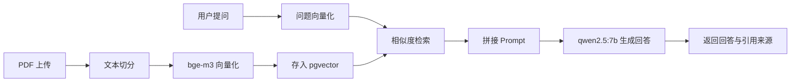

# RAGzhiyan

基于 RAG 与本地大模型的知识智能问答系统。

## 项目简介

RAGzhiyan 是一个基于本地 Ollama 与 pgvector 的私有化知识库问答系统。它把 PDF 文档切分后向量化并存入 PostgreSQL 的 pgvector 扩展，用户提问时先做相似度检索，再把最相关的资料拼接进 Prompt 交给本地大模型生成回答，最终返回回答与可追溯的引用来源。全链路数据都留在本地，不依赖外部云服务。

## 技术栈

- Python
- FastAPI
- PostgreSQL（pgvector）
- Ollama
- Docker
- SQLAlchemy

## 架构图



## 本地部署

1. 启动 Docker 数据库：

```bash
docker run -d --name ragzhiyan-pg \
  -e POSTGRES_USER=admin \
  -e POSTGRES_PASSWORD=password123 \
  -e POSTGRES_DB=kaoyan_db \
  -p 5432:5432 \
  pgvector/pgvector:pg16
```

2. 拉取 Ollama 模型：

```bash
ollama pull bge-m3
ollama pull qwen2.5:7b
```

3. 安装 Python 依赖：

```bash
python -m venv .venv
.\.venv\Scripts\activate
pip install -r requirements.txt
```

4. 准备环境配置并启动 FastAPI：

```bash
copy .env.example .env
uvicorn app.main:app --reload
```

启动后可访问 http://127.0.0.1:8000/docs 查看接口文档。

## 接口说明

### 上传 PDF

`POST /documents/upload`，请求类型为 `multipart/form-data`，文件字段名为 `file`。

```bash
curl -X POST http://127.0.0.1:8000/documents/upload \
  -F "file=@./考研资料.pdf"
```

返回示例：

```json
{
  "id": 1,
  "filename": "考研资料.pdf",
  "num_pages": 120,
  "chunk_count": 240,
  "created_at": "2026-10-13T10:00:00+08:00",
  "message": "已解析并写入 240 个文本块"
}
```

### 智能问答

`POST /ask`，请求类型为 `application/json`。

```bash
curl -X POST http://127.0.0.1:8000/ask \
  -H "Content-Type: application/json" \
  -d "{\"question\": \"什么是马克思主义中国化？\", \"top_k\": 4}"
```

返回示例：

```json
{
  "answer": "马克思主义中国化是指……",
  "sources": [
    {
      "document_id": 1,
      "filename": "考研资料.pdf",
      "page_number": 12,
      "snippet": "马克思主义基本原理同中国具体实际相结合……",
      "score": 0.82
    }
  ]
}
```

## 项目亮点

- 本地私有化：文档、向量与模型推理全部在本机完成，数据不出本地环境
- 引用可追溯：回答附带文档名、页码、片段和相似度，便于核对出处
- 全链路 RAG：从 PDF 上传、切分、向量化、检索到 Prompt 拼接与生成回答，流程完整闭环
